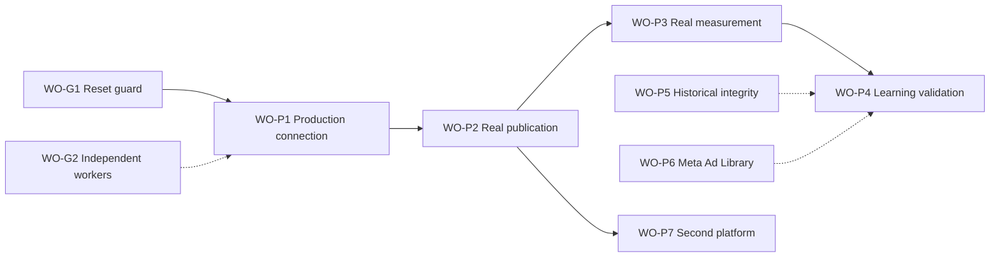

# Phase 2 Handoff — Production Validation and Intelligence Expansion

| Field | Value |
|---|---|
| Repository | `payswapdotorg/zcode-marketing` |
| Prepared for | Team Lead (TL) |
| Origin | TL progress review, 2026-10-30 |
| Reviewed baseline | Commit `f2400d4` (2026-10-30); CI run `40968112495`, all four jobs green |
| Prior state | W0–W7 accepted as complete against their recorded initial scope; they remain closed |
| Location (repo) | `docs/marketing/PHASE2-HANDOFF.md` (landed here 2026-10-30; work orders execute as WORK-REGISTRY.md sections — WO-G1 = W8-1) |
| Suggested commit message | `docs: add phase-2 handoff - production validation and intelligence expansion` |

## 1. Purpose and how to use this document

This handoff converts the 2026-10-30 progress review into an executable Phase 2 plan. It contains nine work orders — `WO-G1`, `WO-G2`, and `WO-P1` through `WO-P7` — each with dependencies, scope, numbered acceptance tests, and explicit evidence requirements. Acceptance tests carry stable identifiers (for example `AT-P2.3`) so that commit messages, CI records, and work-registry entries can reference them unambiguously. The acceptance gates P1–P7 from the review are restated in Section 6 together with the exact artifacts required to close each gate.

The standard applied throughout is the one the review used for W0–W7: acceptance is based on recorded, independently reproducible evidence, not on agent-reported completion. A work order closes only when every numbered acceptance test has a passing result and a linked artifact. The TL may re-sequence work orders as long as the dependency edges in Section 7 are respected; the suggested waves W8–W12 are containers, not new scope definitions. If any instruction here conflicts with an engineering reality discovered during implementation, record the conflict and the resolution in the work registry rather than silently deviating.

## 2. Accepted state and standing constraints

The following waves are accepted as complete on the strength of their recorded evidence and remain closed. No Phase 2 work reopens them; anything that would reopen a wave is a design error to be raised, not a decision to be taken locally.

| Wave | Scope | Key acceptance evidence on record |
|---|---|---|
| W0 | ZCode audit and feature preservation | Architecture boundary and feature-preservation matrix; marketing built into the existing ZCode plugin/tool architecture |
| W1 | Live data-source access | YouTube public metadata and Google Ads Transparency Center verified for United States / YouTube; 184 real ad creatives ingested with idempotency checks and an honest negative control |
| W2 | Temporal evidence store | Persistent SQLite; idempotent ingestion; immutable revisions; as-of queries and snapshots; velocity calculations; persistence across close/reopen |
| W3 | Research, intelligence, workspace | Six of six marketing tools executed through the real ZCode agent server and permission broker with routed GLM model provenance; branded workspace exercised in real Chromium via the MCP Apps host |
| W4 | Creative production handoff | Structured briefs, timed scripts and storyboards, video-generation/thumbnail/copy prompt packs, experiment specifications, explicit review and approval, byte-count-verified asset import, versioned validation rubric, asset comparison |
| W5 | Authorized publishing | YouTube Data API v3 resumable-upload flow, publication verification, idempotency, account health checks, sandbox/production labels, assisted/manual paths, token hygiene tests |
| W6 | Measurement and learning loop | Experiment open from creative hypothesis, permitted connected-account analytics, comparison against preserved forecast, calibration history, next-experiment recommendation, proxy-metric comparison guard |
| W7 | Reliability, isolation, regression | Resumable-upload recovery without retransmitting committed bytes, bounded retries, quota handling, cross-mission isolation, per-mission persistence, credential hygiene, workspace regression, GitHub Actions CI; 19,936-test acceptance run recorded |

Since that review, research integrity is enforced mechanically: `applyResearchIntegrityGate` checks that every evidence reference supporting a ranked opportunity resolves to an advertisement or organic-content record actually observed by the mission, rejects invented references with structured reporting, and refuses to persist invalid hypotheses. The gate is wired into `marketing_rank_opportunities` and `marketing_mission_report`, and the marketing-plugin chain stands at 59/59.

Standing constraints carried into Phase 2. Violating any of these reopens the architecture question the review explicitly closed:

1. **No rewrite.** Marketing continues to run inside ZCode's agent loop, provider registry, permission system, and tool chain. No parallel agent runtime, no replacement store.
2. **Evidence over claims.** Acceptance requires recorded, reproducible evidence. Narrative completion does not close anything.
3. **Integrity gates stay in force.** The research-integrity gate and the proxy-metric comparison guard remain wired into every ranking and reporting path, with passing tests.
4. **Never manufacture history.** Missing observations are recorded as missing — never interpolated, back-filled, or invented.
5. **Environment labels everywhere.** Sandbox and production are distinguished in store records, UI, logs, and reports until production evidence replaces the sandbox label.
6. **W0–W7 stay closed.** All new work is registered as Phase 2 work orders with their own acceptance records.

## 3. Phase 2 definition

**Objective.** Prove the product on a real commercial journey, end to end: a real connected account, a real publication, real measurements, and a demonstrably better subsequent experiment — while expanding intelligence coverage honestly.

**Success statement (from the review).** The next milestone is a real commercial campaign through a real connected account, followed by measured improvement in a subsequent experiment. Gates P1–P7 define what "done" means; the definition-of-done checklist in Appendix B is the closing record.

**Non-goals for Phase 2:**

- Architectural rewrites or a new runtime. The review's closing recommendation is explicit: preserve the existing implementation and build on the current ZCode runtime and marketing plugin.
- New research surface area that is not validated end to end. A connector without recorded ingestion evidence, idempotency checks, and a negative control does not count.
- Treating sandbox results as production acceptance. Sandbox journeys prove the workflow works; they do not close P1–P3.
- Silent expansion of metric semantics. Proxy metrics are never compared against unrelated goal metrics; the comparison guard decides, not the prompt.

## 4. Work-order conventions

Every work order in Section 5 uses the same template: Objective, Why now, Dependencies, Scope, Out of scope, Acceptance tests, Evidence requirements, and Registry and CI notes. Closure requires all four of the following:

1. Every acceptance test passing, with its output recorded.
2. Every artifact listed under Evidence requirements stored at a stable path and linked from the registry entry.
3. A work-registry entry containing: work-order ID, executor identity, base commit, acceptance-test results keyed by `AT-` identifier, artifact links, and the CI run covering the change.
4. Limitations and negative results stated plainly in the entry — including refused operations, quota failures, schema-drift failures, and deferral decisions.

Credentialed acceptance runs (OAuth consent, publishing, analytics collection) are executed as recorded manual runs outside credentials-free CI. Their artifacts are stored under the conventions in Section 8; CI jobs never receive secrets.

## 5. Work orders

### WO-G1 — Sandbox-reset prevention guard

- **Suggested wave:** W8, first item. No other Phase 2 work order starts until this guard suite is green.
- **Lane / owner:** platform lane (TL until WO-G2 staffing lands).
- **Gate served:** prerequisite for everything; not one of P1–P7, but it blocks them.

**Objective.** Make the failure class recorded on 2026-10-30 — the authoring sandbox reset to an older commit while `origin/main` already contained the completed implementation, followed by an undetected parallel rebuild — mechanically impossible to repeat silently. The goal is prevention of duplicated work and accidental regression, not documentation of the next incident.

**Why now.** The review judged the recovery correct but the prevention missing. Phase 2 introduces external credentials and production writes; a silent divergence at that stage risks conflicting publication records, not just wasted work. The guard is cheap now and expensive later.

**Dependencies.** None.

**Scope.**

1. Pre-flight check at session start: fetch `origin`, compare local `HEAD` against `origin/main`, and refuse to accept any work order from a stale base without an explicitly recorded reconciliation (protocol in Appendix A).
2. Work-order base binding: when an agent accepts a work order, the executor records the base commit; before any write, re-assert that `HEAD` is unchanged or that a reconciliation entry exists.
3. Pre-push guard: refuse to push unless the working tree is clean and `HEAD` matches the expected commit.
4. Machine-readable session/workspace checkpoint (JSON) written at session start and end: repository URL, `HEAD`, branch, dirty-file list, open work orders with their base commits, timestamp.
5. Recovery-event recording in the work registry: detection time, local and remote states, divergence summary, decision, ported items, and discarded-work inventory.

**Out of scope.** Changing the reconciliation policy. The current policy stands: the completed remote state wins unless a verified-additive local improvement exists, in which case it is ported and redundant work is discarded.

**Acceptance tests.**

- AT-G1.1 — With local `HEAD` behind `origin/main`, work-order execution refuses and prints a divergence report (local `HEAD`, remote `HEAD`, delta summary).
- AT-G1.2 — With a dirty working tree, push refuses with an explicit message naming the offending files.
- AT-G1.3 — Checkpoint write/read round-trips; schema validation rejects malformed checkpoints.
- AT-G1.4 — A simulated sandbox divergence produces a work-registry recovery event containing all required fields.
- AT-G1.5 — The clean-state path adds no friction: guards pass silently with negligible overhead.

**Evidence requirements.** Guard-suite output (unit plus a simulated integration run), the checkpoint JSON schema, and one sample recovery-event registry entry.

**Registry and CI.** Add the reset-guard suite as a required CI check on every run. The registry entry references the guard commit and the green run.

### WO-P1 — Production YouTube connection

- **Suggested wave:** W8, immediately after WO-G1.
- **Lane / owner:** platform lane.
- **Gate served:** P1 — real account.

**Objective.** Establish a real, user-authorized connection to a brand's YouTube channel through production Google OAuth — stored securely, health-checked, and labeled as production.

**Why now.** Every production gate downstream (P2, P3, P4) depends on this connection. The W5 machinery exists and its wire shapes are real; what is missing is a production consent and a real channel behind it.

**Dependencies.** WO-G1 (guards active before any credentialed work begins).

**Scope.**

1. Complete the production OAuth consent flow with a real Google account that owns the target channel, using a minimal scope set — `youtube.upload`, `youtube.readonly`, `yt-analytics.readonly` — confirmed at implementation time as the least-privilege set satisfying WO-P2 and WO-P3.
2. Secure token storage: protection at rest, full redaction in logs, and refresh handling with rotation covered by tests.
3. Pre-save account health check against the production endpoint, returning real channel identity (channel ID, title, connection metadata).
4. Connection record persisted with `environment=production` and the verified channel identity; re-authorization is idempotent — the same channel updates the record rather than duplicating it.
5. Permission-broker approval required before any write-scope use; denial exits without side effects.
6. Degraded-state handling: revoked or expired authorization marks the connection degraded and fails loudly on next use.

**Implementation notes.** Google OAuth apps in testing mode are limited to a small set of test users; that is acceptable for closing P1 with the brand's own account. Formal app verification should start in parallel if broader rollout is expected. Verify current consent and quota policies at implementation time rather than relying on recorded numbers.

**Out of scope.** Publishing anything (WO-P2), analytics collection (WO-P3), multi-account support.

**Acceptance tests.**

- AT-P1.1 — A real account completes consent; code exchange and token refresh succeed; no plaintext credential appears in any log or artifact, verified by the redaction test.
- AT-P1.2 — The health check returns real production channel metadata and the connection is stored with `environment=production` and the verified channel ID.
- AT-P1.3 — Re-authorizing the same channel updates the existing connection; the connection count does not increase.
- AT-P1.4 — A write-scope operation without permission-broker approval is refused, and the denial path leaves no side effects.
- AT-P1.5 — Revoking access at the provider causes the next health check to fail loudly and the connection to be marked degraded.

**Evidence requirements.** Consent-flow record (screenshots or recording), redacted token-store audit log, health-check response excerpt, connection-record export, and the acceptance-run log — stored as a recorded manual run, no secrets in CI.

**Registry and CI.** The registry entry links all artifacts and states the test-user basis for consent. Token-hygiene tests remain in the credentials-free suite.

### WO-P2 — Real production publication

- **Suggested wave:** W9.
- **Lane / owner:** publishing lane.
- **Gate served:** P2 — real publication.

**Objective.** Publish a user-approved asset to the connected production channel through the existing W5 machinery, and independently verify the published result.

**Why now.** The resumable-upload flow, publication verification, idempotency, and recovery behavior are implemented and sandbox-tested. What closes P2 is one real publication with complete evidence.

**Dependencies.** WO-P1.

**Scope.**

1. Select an asset that already has a recorded W4 review-and-approval entry; the approval record is a hard precondition for upload.
2. Execute the production resumable upload through the existing Data API v3 path; persist the returned video ID and URL in a publication record with `environment=production`.
3. Independently verify by read-back from the production API: fetch by ID and confirm title, privacy state, and duration match expectations.
4. Demonstrate idempotency: re-invoking publication for the same mission and asset does not create a second video.
5. Demonstrate recovery: an interrupted upload resumes without retransmitting committed bytes.
6. Handle quota exhaustion explicitly: bounded retries, a clear quota-failure state, and no partial publication state.
7. Keep the assisted/manual path available for unsupported publication routes, with verification evidence recorded manually.

**Out of scope.** Any asset lacking an approval record; scheduling or campaign orchestration beyond what already exists.

**Acceptance tests.**

- AT-P2.1 — An approved asset uploads successfully; the publication record persists the video ID and URL with `environment=production`.
- AT-P2.2 — Independent read-back matches the expected title, privacy state, and duration, and the verification response is stored.
- AT-P2.3 — An interrupted upload resumes without retransmitting committed bytes, demonstrated by byte-range logs.
- AT-P2.4 — Duplicate-publication prevention: re-invocation is a no-op returning an explicit already-published result.
- AT-P2.5 — Quota-exceeded responses produce an explicit failure state; no partial record is written.

**Evidence requirements.** Upload session logs, the video ID and public URL, the read-back verification response, the pre-upload approval record, and the publication record.

**Registry and CI.** Recorded manual run; the registry entry links all artifacts. The credentials-free suite keeps the existing sandbox wire-shape tests green.

### WO-P3 — Real measurement

- **Suggested wave:** W9–W10.
- **Lane / owner:** measurement lane.
- **Gate served:** P3 — real measurement.

**Objective.** Collect real analytics for the published production asset into the temporal store, with observation-time semantics and source labeling that keep first-party observations strictly separate from platform-reported public metadata.

**Why now.** The W6 comparison loop is only as good as the observations fed to it. Real analytics turn the preserved-forecast comparison from a sandbox exercise into a production capability, and they are the input WO-P4 needs for real learning validation.

**Dependencies.** WO-P2.

**Scope.**

1. Collect permitted connected-account analytics for the production publication (YouTube Analytics within granted scopes) on at least two distinct collection times.
2. Land every observation in the temporal store with an explicit observed-at timestamp and a source label distinguishing analytics-grade data from public metadata.
3. Compute and record velocity across the collection window.
4. Fail loudly on scope revocation or API error; record the failure; never zero-fill missing observations.
5. Regression-check as-of queries across the newly landed production observations.

**Out of scope.** Third-party channel analytics beyond permitted scopes; any estimate of metrics the API does not provide.

**Acceptance tests.**

- AT-P3.1 — Analytics for the production video land in the store with observed-at timestamps and the correct source label.
- AT-P3.2 — Two or more distinct collection times yield a valid velocity calculation.
- AT-P3.3 — Queries can filter by source label; analytics and public metadata are never silently merged.
- AT-P3.4 — A revoked-scope simulation fails loudly, records the failure, and marks collection degraded; no synthetic observations appear.

**Evidence requirements.** Redacted analytics responses, an as-of query export over the new observations, the velocity report, and the failure-path log.

**Registry and CI.** The registry entry links artifacts and collection timestamps. Credentials-free tests cover store semantics with fixtures.

### WO-P4 — Real-world learning validation

- **Suggested wave:** W10–W11. Requires two successive real experiments; plan the calendar accordingly.
- **Lane / owner:** measurement lane, with creative-lane support.
- **Gate served:** P4 — learning.

**Objective.** Demonstrate on real production outcomes that the closed loop improves against the declared objective: open an experiment from a creative hypothesis, measure it, compare actuals against the preserved forecast, record calibration, and ground the next experiment's recommendation in the measured outcome.

**Why now.** This is the review's core definition of the next milestone. A sandbox experiment proves the workflow works; only successive real experiments can show that the system has learned to improve real commercial outcomes.

**Dependencies.** WO-P3.

**Scope.**

1. Experiment 1: open from a creative hypothesis with a preserved forecast and a declared objective metric family; publish, measure, compare actuals against the forecast; record calibration history and forecast error.
2. Generate the next-experiment recommendation explicitly grounded in experiment 1's measured outcome — the recommendation must cite the stored records it derives from.
3. Experiment 2: execute the recommendation as a real publication, measure it against the same declared objective family, and record the result in calibration history.
4. Keep the proxy-metric guard active: comparisons happen only within the declared metric family; mismatches are rejected and the rejection is visible in structured output.
5. Keep the research-integrity gate active on every ranking and reporting path used (plugin baseline 59/59; the count updates as tests are added, and the current run reports its own count).

**Out of scope.** Claiming commercial success from a single pair of experiments; statistical-significance claims beyond what the data supports. State sample-size limitations plainly in the report.

**Acceptance tests.**

- AT-P4.1 — The full lifecycle — hypothesis, publish, measure, compare, calibration, recommendation — executes on production data with records at each step.
- AT-P4.2 — The proxy-metric guard rejects a mismatched metric-family comparison in test, with the rejection visible in structured output.
- AT-P4.3 — Experiment 2's recommendation cites experiment 1's measured outcome and forecast error, and the citation resolves to stored records.
- AT-P4.4 — All evidence references used in ranking and reporting pass the research-integrity gate; no invented references are persisted.
- AT-P4.5 — Experiment 2's measured outcome is compared against its own preserved forecast and recorded in calibration history.

**Evidence requirements.** Experiment records for both experiments, the forecast-versus-actual report, the calibration-history export, the recommendation record, and the updated plugin test run.

**Registry and CI.** The registry entry states each experiment's declared objective family and links all artifacts. Integrity-gate and guard tests remain in CI.

### WO-P5 — Historical intelligence integrity

- **Suggested wave:** starts W8, completes W10. Continuous; no external dependency.
- **Lane / owner:** research lane.
- **Gate served:** P5 — historical integrity.

**Objective.** Make historical semantics explicit, reproducible, and honest: separate actual historical source records from first-party observations, platform-reported dates, and estimates — and enforce mechanically that missing history is never manufactured.

**Why now.** This is the review's third priority. Real measurement and learning depend on trustworthy as-of semantics, and the keyless organic feed's rolling window of roughly 15 recent uploads means most history is absent by default. Integrity here protects everything downstream.

**Dependencies.** None external; builds on the W2 temporal store.

**Scope.**

1. Record-type separation: every record carries source, observed-at, and reported-at fields, with a record type distinguishing source-reported dates, first-party observations, and estimates; queries can filter on each.
2. As-of reproducibility: fixture-based tests prove that the same ingestion history yields identical snapshots for the same as-of time.
3. Explicit absence: queries before coverage return a stated no-observation result, never interpolated values; the no-observation result is a first-class, testable outcome on every access path (API, panel, report).
4. Coverage disclosure in the workspace UI: source coverage windows and their limits are visible wherever those sources feed ranked output (Section 11).
5. An enforced anti-fabrication invariant — code plus test — that no ingestion or query path synthesizes observations for times the system did not observe.

**Out of scope.** Purchasing or integrating third-party historical datasets; changing the store engine (no rewrite).

**Acceptance tests.**

- AT-P5.1 — As-of queries over fixture histories are reproducible: identical inputs produce identical snapshots, verified by test.
- AT-P5.2 — Pre-coverage queries return the explicit no-observation result on every access path.
- AT-P5.3 — Record-type and timestamp fields are present and filterable on all new production observations.
- AT-P5.4 — The UI shows the coverage window and limits for each active source at the point of use.
- AT-P5.5 — The anti-fabrication invariant test rejects any record whose observed-at precedes the system's first observation of that entity.

**Evidence requirements.** Fixture test runs, exported as-of snapshots including one no-observation case, and UI screenshots showing coverage disclosure.

**Registry and CI.** The fixture suite joins the credentials-free CI suite.

### WO-P6 — Advertising-source expansion: Meta Ad Library

- **Suggested wave:** W11. Parallel track; may start earlier if a worker is available.
- **Lane / owner:** research lane.
- **Gate served:** supports P4 and P5; no separate lettered gate, but a required work order (review priority 4).

**Objective.** Add Meta Ad Library as a second verified advertising source under legitimate credentials, meeting the same evidentiary standards as the Google Ads Transparency Center connector, with an explicit per-field coverage matrix.

**Why now.** Single-source advertising intelligence is fragile — one undocumented wire-format change degrades the product. A second source broadens coverage and, more importantly, forces the coverage-matrix discipline to generalize across connectors.

**Dependencies.** None hard. Recommended after the P1–P3 production pattern is stable, so credential work is not competing for attention.

**Scope.**

1. Obtain legitimate access to the Meta Ad Library API (ads-research permission basis) and record the permission basis in the connector.
2. Implement ingestion to the W1 standards: idempotency checks, an honest negative control, explicit limitation notes, per-source provenance.
3. Produce a per-field coverage matrix — provided, unavailable, or partial (for example, where delivery fields are platform-reported or bucketed) — and surface it in the UI.
4. Maintain cross-source dedup and provenance so ranked output can attribute every record to its source.
5. Investigate additional permitted commercial ad sources and record their access status honestly. Nothing is wired up without verified access; investigation results are recorded either way.

**Out of scope.** Scraping or undocumented endpoints; any source whose terms cannot be complied with; implying fields the source does not actually provide.

**Acceptance tests.**

- AT-P6.1 — Real Meta ad creatives are ingested idempotently (re-run does not duplicate), with the negative control recorded.
- AT-P6.2 — The coverage matrix exists for every ingested field — distinguishing provided, unavailable, and partial — and is displayed in the UI.
- AT-P6.3 — Cross-source queries preserve per-source provenance in results.
- AT-P6.4 — Connector failure (API error or wire-format drift) fails loudly and records the failure; no silent partial data.

**Evidence requirements.** Ingestion logs with counts, the negative-control result, the coverage-matrix document, permission notes, and the failure-path log.

**Registry and CI.** Adapter contract tests join the credentials-free suite; a credentials-gated ingestion run is a recorded manual run.

### WO-P7 — Second social platform

- **Suggested wave:** W12.
- **Lane / owner:** platform lane, with creative and measurement support.
- **Gate served:** P6 — second platform.

**Objective.** Deliver a complete, verified research-to-publication journey on a second social platform — TikTok or an alternative chosen by verified access and user demand — not merely a research connector.

**Why now.** By this point the single-platform journey will have been proven twice (sandbox and production). Reusing the pattern on a second platform is the cheapest way to prove the architecture generalizes, and the most honest way to discover where it does not.

**Dependencies.** WO-P2 and WO-P3 (the pattern exists); WO-G2 (staffed lanes make a parallel track possible).

**Stage 0 — Selection gate (a recorded decision of its own).**

1. Verify access paths for each candidate platform: research data, publishing API, and analytics; record permission feasibility and terms constraints.
2. Record user-demand evidence for the leading candidate.
3. Produce a selection memo naming the chosen platform, the access basis, and what will be delivered — or an explicit deferral if no candidate has verified access. Deferral is an acceptable outcome; pretending access is not.

**Scope (after selection).**

1. Research connector producing evidence-backed records that pass the research-integrity gate.
2. Creative adaptation through the existing brief, prompt-pack, and validation-rubric flow, using platform-appropriate formats.
3. Publication: direct API path where available, with the permission broker engaged; otherwise the assisted/manual path with verification evidence recorded manually.
4. Measurement: permitted analytics where available; otherwise an explicit measurement limitation recorded, with no invented metrics.
5. One complete end-to-end journey at reduced depth compared with YouTube — the gate asks for a complete verified journey, not maximal depth.

**Out of scope.** Deep per-platform optimization; simultaneous work on a third platform.

**Acceptance tests.**

- AT-P7.1 — The selection memo records verified access and demand evidence, or a deferral with reasons; the decision is in the work registry.
- AT-P7.2 — Research on the chosen platform produces evidence-backed records that pass the research-integrity gate.
- AT-P7.3 — Publication, direct or assisted, is verified with stored evidence: content live at a verifiable location.
- AT-P7.4 — Measurement is either collected within permitted scopes or recorded as a limitation; no synthetic metrics appear.

**Evidence requirements.** Selection memo; per-step records mirroring WO-P1 through WO-P4 at reduced depth; limitation notes.

**Registry and CI.** One registry entry per stage; the journey record links all steps.

### WO-G2 — Independent worker execution

- **Suggested wave:** starts W8, continuous through W12.
- **Lane / owner:** TL.
- **Gate served:** P7 — team execution.

**Objective.** Staff the three role lanes with actual independent workers, so the TL shifts from personally implementing every lane to reviewing contracts, integration, evidence, and acceptance.

**Why now.** The registry honestly records that Workers A, B, and C are role lanes of a single agent. That makes the TL a throughput and independent-review bottleneck exactly when Phase 2 adds parallel tracks. The review requires this to change, and gates it.

**Dependencies.** None; start immediately.

**Scope.**

1. Onboard three independent worker identities (distinct sessions or accounts, whatever the runtime supports) and assign lanes — research, creative, publishing/measurement. The exact split is the TL's call; the requirement is independence, not the specific mapping.
2. Redefine the TL role: assign work orders, review contracts before implementation, review integration between lanes, review evidence before closure, and sign off acceptance. The TL does not personally implement lane work except where a lane is blocked.
3. Record every review as a registry entry: reviewer, work order, findings, decision.
4. Demonstrate concurrency: two lanes shipping work orders in the same wave, with evidence.

**Out of scope.** Replacing the work-registry discipline; changing the wave convention.

**Acceptance tests.**

- AT-G2.1 — Three distinct worker identities execute work orders, recorded in the registry with their identities.
- AT-G2.2 — Every work order closed in this phase carries TL review sign-offs: contract, integration, evidence, acceptance.
- AT-G2.3 — At least one cross-lane integration review is recorded with findings and resolutions.
- AT-G2.4 — Two lanes ship in the same wave, evidenced by registry entries and commits from distinct identities.

**Evidence requirements.** Registry entries with worker identities, review records, and the concurrency evidence.

**Registry and CI.** The registry schema gains executor identity as a required field if it is not already present.

## 6. Acceptance gates P1–P7

The gates below are the review's definitions, restated with the work orders that close them and the artifacts that constitute closure. A gate closes only when its evidence is stored, linked from the registry, and independently checkable by the reviewer — the same standard that closed W0–W7.

| Gate | Closes with | Must demonstrate | Required artifacts |
|---|---|---|---|
| P1 — Real account | WO-P1 | OAuth connection and permission verification with a real account | Consent record, health-check response, production connection record |
| P2 — Real publication | WO-P2 | An approved asset successfully published and independently verified | Approval record, publication record, read-back verification |
| P3 — Real measurement | WO-P3 | Actual analytics collected from that publication | As-of export with observed-at timestamps, velocity report |
| P4 — Learning | WO-P4 | A subsequent experiment recommendation grounded in real outcomes | Forecast-versus-actual report, calibration history, recommendation record |
| P5 — Historical integrity | WO-P5 | Reproducible as-of queries with clear source and observation-time semantics | Fixture runs, snapshot exports, no-observation case, UI disclosure |
| P6 — Second platform | WO-P7 | A complete, verified research-to-publication journey on another platform | Selection memo, per-step journey records |
| P7 — Team execution | WO-G2 | Independently assigned workers, integration reviews, and evidence | Registry entries with worker identities, review records, concurrency evidence |

Two work orders do not map to a lettered gate but are required: WO-G1 is a hard prerequisite for all credentialed and production work; WO-P6 is reviewed against its own acceptance tests and feeds gates P4 and P5.

## 7. Sequencing and dependencies

The dependency edges below are the contract. The waves are suggested containers that preserve the repository's wave-based registry convention; the TL may re-sequence provided the edges hold and the registry records the actual sequence.

| Suggested wave | Work orders in flight | Expected gate progress at wave close |
|---|---|---|
| W8 | WO-G1, WO-G2 start, WO-P5 start, WO-P1 | Reset guard active in CI; P1 closed |
| W9 | WO-P2, WO-P3 start, WO-G2 continue, WO-P5 continue | P2 closed |
| W10 | WO-P3 complete, WO-P4 experiment 1, WO-P5 complete | P3 and P5 closed |
| W11 | WO-P4 experiment 2 and recommendation, WO-P6, WO-G2 evidence | P4 closed; P7 evidence accumulating |
| W12 | WO-P7 selection memo and first journey | P6 closed; phase-2 review ready |

Two sequencing notes. First, WO-G1 precedes all credentialed work deliberately: production OAuth must never exist in a workspace that can silently diverge. Second, WO-G2 is continuous — the later parallel tracks (WO-P6 alongside WO-P4, WO-P7 after WO-P2/P3) assume the lanes are independently staffed by then; if they are not, the dependency edges force serialization and the wave plan stretches.

## 8. Evidence and work-registry conventions

1. **Registry entry per work order.** Required fields: work-order ID, title, executor identity, base commit, acceptance-test results keyed by `AT-` identifier, artifact links, CI run link, limitations, and — for credentialed runs — the storage location of the manual-run artifacts.
2. **Artifact storage.** A predictable path convention such as `evidence/<wave>/<work-order>/` with stable file names; every artifact referenced by repository-absolute path from the registry entry.
3. **Redaction.** No tokens, refresh tokens, client secrets, or personal data in stored artifacts; redaction is verified by test wherever feasible, following the existing token-hygiene pattern.
4. **Reproducibility.** The reviewer must be able to re-derive key claims without the executor: re-run a fixture query, re-fetch a published video by ID, re-run the guard suite. Narrative-only closures are rejected.
5. **Negative results are recorded, not hidden.** Negative controls, refused operations, quota failures, schema-drift failures, and deferral decisions are all registry-worthy evidence.
6. **Recovery events.** Whenever divergence is detected — including false alarms — a recovery event is recorded per Appendix A.
7. **Production claims require production records.** Any sandbox artifact cited in a phase report is labeled as such, without exception.

## 9. CI and engineering-quality requirements

1. All four existing jobs stay green on `main` on every merge: governance (lint, schema, architecture), the full typecheck chain, the root unit suite and plugin chains, and the desktop Electron E2E container (four replay-admitted specifications; the upstream capture-mode test requiring external credentials remains excluded from credentials-free runs).
2. The reset-guard suite (WO-G1) becomes a required CI check.
3. Per-run test counts are printed in job summaries. The earlier 19,936-test acceptance run remains valuable history, but a phase report may only cite counts produced by the runs it references — as the review itself noted, the latest run's numbers come from the latest run's logs.
4. Adapter contract tests (Google Ads Transparency Center now; Meta Ad Library under WO-P6) fail loudly on wire-format drift. Drift never results in silent partial data.
5. The credentials-free policy is preserved: no secrets in CI, and credentialed acceptance runs are recorded manual runs with artifacts under the Section 8 conventions.
6. The research-integrity gate and proxy-metric guard tests remain in the marketing-plugin chain, which currently stands at 59/59; the count is per-run and updates as tests are added.

## 10. Risk register

| ID | Risk | Impact | Likelihood | Mitigation | Owner |
|---|---|---|---|---|---|
| R1 | Google OAuth verification delays restrict production consent beyond the brand's own test users | High | Medium | Close P1–P3 with the brand's own account under testing-mode consent; start app verification in parallel if wider rollout is expected | Platform lane |
| R2 | YouTube upload quota exhaustion interrupts publication | Medium | Medium | Quota accounting before upload, bounded retries, explicit quota-failure state (AT-P2.5); verify current quota policy at implementation time | Publishing lane |
| R3 | Google Ads Transparency Center undocumented wire format drifts and breaks ingestion | High | Medium | Adapter isolation, contract tests that fail loudly on schema drift, no silent partial data; same discipline carried into WO-P6 | Research lane |
| R4 | Sandbox reset or stale-base divergence recurs | High | Medium | WO-G1 guards active from W8 and enforced in CI | TL |
| R5 | TL remains a single-agent bottleneck; lanes cannot run in parallel | High | High | WO-G2 staffing from W8; TL review-only role per AT-G2.2 | TL |
| R6 | Proxy metrics silently compared against unrelated goal metrics | High | Medium | Comparison guard retained and tested (AT-P4.2); TL reviews the declared objective family at experiment setup | Measurement lane |
| R7 | Stakeholders expect ROAS, spend, or targeting from public sources | Medium | High | Coverage matrix (Section 11) visible in UI and reports; never imply unavailable data | Research lane |
| R8 | Second-platform work balloons into connector rewrites | Medium | Medium | WO-P7 stage-0 selection gate; reuse the P1–P4 pattern at reduced depth; assisted publication where APIs are unavailable | Platform lane |
| R9 | Credentialed manual runs leak secrets into stored artifacts | High | Low | Redaction rules (Section 8), token-hygiene tests, credentials-free CI policy | TL |

## 11. Coverage-limit disclosure requirements

The connectors already record these limitations; the requirement is that they remain visible in the UI at the point of use and in any report that draws on the underlying records. Removing or obscuring a disclosure is a regression, not a cleanup.

| Source | Provides | Does not provide | Disclosure requirement |
|---|---|---|---|
| Google Ads Transparency Center | Real advertisers and ad creatives; platform-reported delivery dates | Impressions, spend, clicks, CTR, conversions, ROAS, targeting; a complete serving-surface breakdown | Label at ingestion; visible wherever ranked output uses these records |
| YouTube keyless organic feed | Recent uploads, creative metadata, current public view-count observations — a rolling window of roughly 15 uploads | A complete historical archive | Show rolling-window coverage in the workspace UI |
| YouTube Analytics (production, Phase 2) | Permitted connected-account metrics for owned publications | Third-party analytics beyond granted scopes | Scope list shown at connection time and in measurement reports |
| Local sandbox publishing endpoint | Real API wire shapes for testing | Any production behavior | `environment=sandbox` label everywhere it appears |

## Appendix A — Sandbox-reset incident and guard specification

**Incident record (2026-10-30).** The authoring sandbox was reset to an older commit while `origin/main` already contained the completed implementation. A parallel rebuild ran before the divergence was detected. Reconciliation: the completed remote state won, the one verified-additive improvement was ported, and redundant work was discarded. The review judged the recovery correct and required permanent prevention; WO-G1 implements it.

**Guard protocol.**

1. **Session start (pre-flight).** Fetch `origin`; resolve local `HEAD` and `origin/main`. If local is behind, refuse work-order execution and print a divergence report. If local is ahead by unpushed commits, verify them against the last checkpoint. If the histories have diverged, invoke the reconciliation procedure before any work begins.
2. **Reconciliation procedure.** Record a recovery event with the fields below; select the completed state (remote wins unless a verified-additive local improvement exists); port or discard accordingly; update the checkpoint; resume.
3. **Work-order base binding.** The executor records the base commit when accepting a work order; before any write, re-assert that `HEAD` matches the recorded base or that a reconciliation entry exists.
4. **Pre-push.** Assert a clean tree and the expected `HEAD`; refuse otherwise.
5. **Session end.** Write the checkpoint for the next session's pre-flight.

**Checkpoint schema (JSON).** Repository URL; current `HEAD`; branch; dirty-file list; open work orders with their base commits; timestamp; last recovery-event ID, if any.

**Recovery-event registry fields.** Detection time; local `HEAD`; remote `HEAD`; divergence summary; decision; ported items; discarded-work inventory; executor identity.

## Appendix B — Phase 2 definition of done

- [ ] All four CI jobs green on the final commit, plus the reset-guard suite as a required check
- [ ] WO-G1 closed: pre-flight, base-binding, pre-push, checkpoint, and recovery-event guards active and enforced in CI
- [ ] P1 closed: production connection with recorded consent, health check, and permission-broker verification
- [ ] P2 closed: an approved asset published to the production channel and independently verified by read-back
- [ ] P3 closed: real analytics in the temporal store with observed-at timestamps, source labels, and velocity
- [ ] P4 closed: two successive real experiments with calibration history and a recommendation grounded in measured outcomes
- [ ] P5 closed: reproducible as-of queries, explicit no-observation results, anti-fabrication invariant, and coverage disclosure in the UI
- [ ] WO-P6 closed, or explicitly deferred with recorded reasons and access status
- [ ] P6 closed: complete verified second-platform journey — or, if the selection gate honestly defers because no candidate has verified access, the deferral is recorded and the gate remains open; do not close it with sandbox-only work
- [ ] P7 closed: three independent worker identities, TL review sign-offs on every closure, a recorded integration review, and concurrency evidence
- [ ] No architectural rewrite: ZCode runtime, plugin architecture, permission broker, and temporal store preserved throughout
- [ ] Research-integrity gate and proxy-metric guard active with green per-run tests
- [ ] Limitations, negative results, and recovery events documented per Section 8
